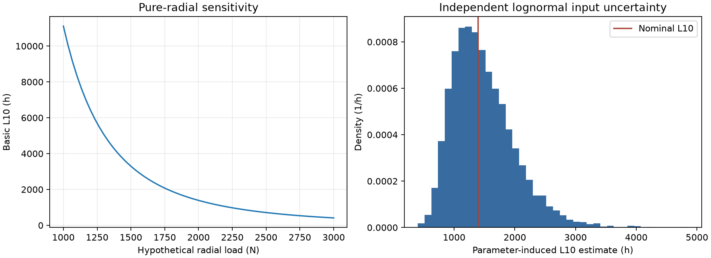

# Bearing Life & Reliability Lab

Mechanical engineers and engineering students need transparent preliminary fatigue-life and sensitivity estimates for hypothetical bearings. This Python/NumPy lab computes basic L10, checks units, exposes load/rating/speed elasticities, and compares seeded parameter uncertainty with an analytic lognormal reference. Matplotlib produces reproducible engineering plots.

## Equations and applicability

L10 in million revolutions = (C/P)^p; p=3 for ball and 10/3 for roller bearings. Hours = 10^6(C/P)^p/(60 n), with C/P in consistent force units and n in rpm. Here P=Fr is assumed for pure radial load; nonzero axial load rejects because catalog X/Y factors and bearing-specific applicability are absent. L10 refers to a fatigue-life population rating at 90% reliability, not a guarantee or mean individual lifetime. Methods and public primary references are in docs/RESEARCH.md.

## Requirements and usage

Python 3.12, project-local NumPy and Matplotlib. CPU only, 500–5000 samples.

```sh
python3 -m venv .venv
.venv/bin/pip install -r requirements.lock
OPENBLAS_NUM_THREADS=2 MPLBACKEND=Agg .venv/bin/python -m unittest discover -s tests -v
OPENBLAS_NUM_THREADS=2 MPLBACKEND=Agg .venv/bin/python src/bearing.py examples/bearing.json results
```

Example C=10 kN, Fr=2 kN and n=1500 rpm gives 125 million revolutions and 1388.8889 h. JSON/Markdown and bearing.png include sensitivity and supplied-parameter uncertainty. Independent lognormal inputs use arithmetic means/CVs; analytic output quantiles are compared to Monte Carlo, whose residual errors are reported. These parameter quantiles are separate from L10's 90% fatigue reliability.

## Limits, business value and security

No certified ISO implementation, manufacturer catalog, bearing selection, modified reliability factors, static load check, minimum-load/skidding check, axial calculation, contamination/lubrication adjustment or other failure modes. Constant equivalent radial load/speed and conventional rolling-fatigue conditions only. Hypothetical values/CVs are not real catalog evidence. No network execution or personal data; maximum 64 KiB config. Portfolio value is auditable equations, dimensional/scaling tests and analytic uncertainty comparison.



## Verification and publication

Evidence labels: VERIFIED = checked against a stated criterion; OBSERVED = measured execution; INFERRED = interpretation; HYPOTHESIS = proposed explanation; NOT_VERIFIED = missing evidence. Local status and executed commands are in `results/validation.json` and `docs/REVIEW.md`. Synthetic validation establishes implementation behavior, not production accuracy.

Manual GitHub preparation only: separate local Git repository, original MIT code, no push or PR. CI uses public dependency registries and requires no secrets. See `docs/PROVENANCE.md` for dependency and advisory review scope.

## License

MIT; see LICENSE.

## Reproducing development checks

Optional public-registry dependency review: `python3 tools/dependency_audit.py .` writes `results/dependency-audit.json`. This developer check uses the free OSV API and is separate from offline application execution. Zero listed advisories does not prove absence of vulnerabilities. License evidence is in results/licenses.json and, for scientific projects, results/python-licenses.json.

Install `requirements-dev.txt` to run the recorded Ruff 0.17.0 source checks. Commands, actual versions, failed attempts, review corrections and measured peak RSS are retained in results/validation.json, results/tool-versions.json and docs/REVIEW.md. Hosted CI remains NOT_VERIFIED.
